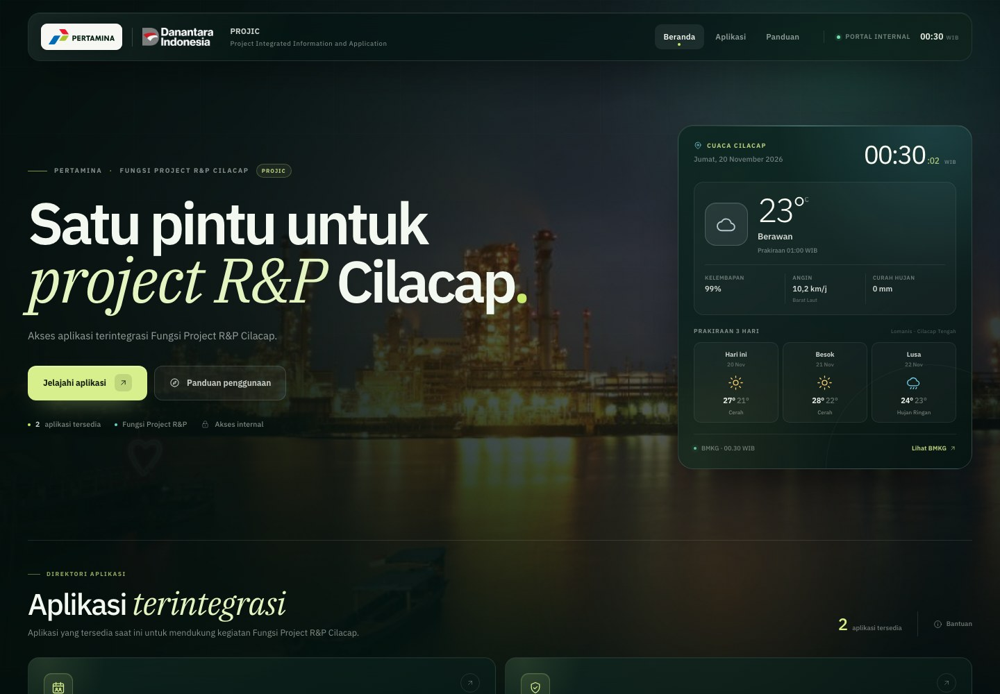

# PROJIC

**Project Integrated Information and Application** — portal internal Fungsi
Project R&P Cilacap. PROJIC menjadi pintu masuk aplikasi internal, saat ini:

- **e-MIRA** — e-lektronik Manajemen Informasi Ruang & Agenda.
- **Tracking Perizinan GRC** — pemantauan status dan progres perizinan Green
  Refinery Cilacap.

Portal juga menampilkan waktu live WIB, informasi cuaca dari API BMKG, dan
prakiraan tiga hari.

## Pratinjau



## Menjalankan secara lokal

Buka `index.html` langsung di browser, atau jalankan server lokal:

```bash
cd WebSite_ProjectRnP
python3 -m http.server 8080
```

Lalu buka `http://localhost:8080`.

> Sebagian besar aset dan aplikasi tersimpan lokal. Informasi cuaca memerlukan
> koneksi internet karena dimuat dari API BMKG.

## Struktur repositori

```text
.
├── index.html
├── README.md
├── robots.txt
├── .gitignore
├── .nojekyll
├── apps/
│   ├── README.md
│   ├── e-mira/
│   │   └── index.html       # e-MIRA — satu berkas mandiri
│   └── tracking-perizinan-grc/
│       └── index.html       # Tracking Perizinan GRC — satu berkas mandiri
├── docs/
│   ├── preview-desktop.jpg
│   └── preview-full.jpg
└── assets/
    ├── css/styles.css
    ├── fonts/
    │   ├── ibm-plex-sans-latin.woff2
    │   └── ibm-plex-serif-italic-latin.woff2
    ├── images/
    │   ├── cilacap-refinery.jpg
    │   └── favicon.svg
    ├── js/
    │   ├── apps.js          # daftar aplikasi
    │   └── main.js          # render direktori, jam, cuaca, dialog
    └── logos/
        ├── pertamina.svg
        ├── danantara-main.png
        ├── danantara-mark.png
        └── danantara-reverse.png
```

## Lokasi aplikasi

Semua aplikasi HTML disimpan di folder **`apps/`**. Setiap aplikasi memiliki
foldernya sendiri agar seluruh asetnya tetap menyatu.

- Aplikasi satu berkas: misalnya
  `apps/nama-aplikasi/index.html`.
- Aplikasi dengan CSS/JS/gambar: simpan **semua aset di dalam folder
  aplikasinya**, bukan di folder `assets/` milik portal.
- Gunakan path relatif di dalam aplikasi, misalnya `style.css` atau
  `gambar/logo.png`.
- Panduan singkat ada di [apps/README.md](apps/README.md).

## Mendaftarkan aplikasi

Tambahkan satu entri pada **`assets/js/apps.js`**:

```js
{
  id: "nama-aplikasi",
  name: "Nama Aplikasi",
  subtitle: "Keterangan singkat",
  description: "Deskripsi yang tampil pada kartu aplikasi.",
  category: "Project",
  icon: "grid",
  href: "apps/nama-aplikasi/index.html",
  tags: ["Fitur 1", "Fitur 2"],
  note: "Akses internal"
}
```

Jumlah aplikasi pada hero dan direktori akan menyesuaikan otomatis. Bila hanya
ada satu aplikasi, portal menampilkan kartu besar; bila dua atau lebih, semua
aplikasi tampil sebagai kartu direktori yang setara.

Ikon yang tersedia: `meeting`, `grid`, `chart`, `folder`, `shield`, `tools`.
Tautan `http://` atau `https://` dibuka di tab baru.

## Cuaca BMKG

Kartu cuaca memuat prakiraan terdekat, kelembapan, angin, curah hujan, serta
prakiraan **Hari ini, Besok, dan Lusa**. Sumber data:

```text
https://api.bmkg.go.id/publik/prakiraan-cuaca?adm4=33.01.22.1001&x=1
```

API publik BMKG tersebut gratis dan tidak memerlukan API key. Data disimpan
sementara di `localStorage` selama 30 menit. Tautan **Lihat BMKG** menuju
prakiraan resmi BMKG untuk Cilacap.

Lokasi dapat diubah melalui `WEATHER_URL` di `assets/js/main.js`. Tautan BMKG
berada pada elemen `.wx-link` di `index.html`.

## Navigasi aplikasi

- **e-MIRA** menampilkan menu **PROJIC** di sidebar setelah pengguna masuk.
- **Tracking Perizinan GRC** memiliki tombol **Home** untuk kembali ke tampilan
  awal aplikasi dan tombol **PROJIC** untuk kembali ke portal.

## Tipografi dan tampilan

- **IBM Plex Sans** untuk antarmuka dan judul.
- **IBM Plex Serif Italic** untuk aksen judul.
- Font disematkan sebagai data URI agar tetap tampil saat halaman dibuka
  langsung dari `file://`.
- Jam live WIB ditampilkan besar pada kartu cuaca dan tetap tersedia pada
  header.

## Publikasi ke GitHub Pages

1. Buat repositori baru di GitHub, lalu dari folder proyek jalankan:

   ```bash
   git init
   git add .
   git commit -m "Initial PROJIC portal"
   git branch -M main
   git remote add origin https://github.com/USERNAME/NAMA-REPO.git
   git push -u origin main
   ```

2. Di GitHub, buka **Settings → Pages**.
3. Pilih **Deploy from a branch**, branch `main`, folder **/(root)**.
4. Simpan. Situs akan tersedia di
   `https://USERNAME.github.io/NAMA-REPO/`.

`.nojekyll` sudah disertakan agar GitHub Pages menyajikan seluruh berkas statis
tanpa pemrosesan Jekyll. Semua tautan aplikasi menggunakan path relatif sehingga
tetap berfungsi pada URL project page GitHub.

> **Catatan keamanan:** portal dan aplikasi berisi informasi internal. Gunakan
> repositori privat atau kontrol akses organisasi. `robots.txt` dan meta
> `noindex` hanya mengurangi indeks mesin pencari, bukan pengganti autentikasi.

## Sumber data dan aset

- Data cuaca: [API publik BMKG](https://api.bmkg.go.id/publik/prakiraan-cuaca?adm4=33.01.22.1001&x=1) (gratis).
- Prakiraan resmi: [BMKG — Prakiraan Cuaca Cilacap](https://www.bmkg.go.id/cuaca/prakiraan-cuaca/33.01.22.1001).
- Logo Pertamina: [Wikimedia Commons — Pertamina Logo.svg](https://commons.wikimedia.org/wiki/File:Pertamina_Logo.svg).
- Logo Danantara Indonesia: [Media Center / Asset BPI Danantara](https://www.danantarindonesia.co.id/id/media-center/asset).
- Foto Kilang Pertamina Cilacap: [Wikimedia Commons — Kilang Pertamina Cilacap.jpg](https://commons.wikimedia.org/wiki/File:Kilang_Pertamina_Cilacap.jpg),
  sumber Pemerintah Kabupaten Cilacap (domain publik).
- Font: IBM Plex Sans dan IBM Plex Serif (Google Fonts, SIL Open Font License).

Logo merupakan merek dagang pemiliknya masing-masing dan digunakan untuk
keperluan internal portal ini. Pastikan penggunaan sesuai pedoman brand
Pertamina dan Danantara Indonesia.
